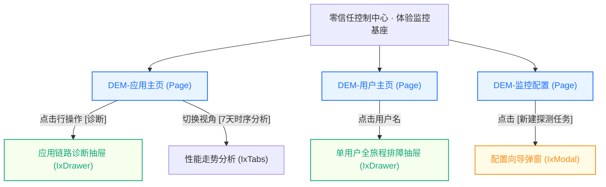

# 1.1 页面拓扑与路由关系提取规则 (Topology Extractor)

## 一、解析目标
将静态 HTML 文件、方案目录或复杂原型中隐藏的“页面跳转”、“弹窗浮层”、“下钻抽屉”以及“Tab 视图切换”等交互流，逆向还原为**清晰的结构层级拓扑与 Mermaid 路由图**。

---

## 二、识别模式与特征标记

### 1. 顶层页面 (Page)
- **特征**：独立的 HTML 入口文件、`window.DEM_ROUTES` 字典映射项、顶层菜单 `
` / `
` 对应的目标。
- **转换定性**：在内部平台作为独立的路由页面（Vue Router 路由表中的独立 `path`）。

### 2. 抽屉详情/排障面板 (Drawer)
- **特征**：
  - Alpine.js 标记：`x-show="isDrawerOpen"`、`x-transition:enter`、`@click="openDrawer(...)"`；
  - CSS 特征：`fixed inset-y-0 right-0`、`z-50`、`dem-drawer`、带暗色遮罩（backdrop）；
  - 触发点：表格行内的“诊断”、“查看详情”、“排障定位”等操作按钮。
- **转换定性**：属于对应 Page 的子组件，映射为 `<IxDrawer>`，不设独立路由，由当前页面状态受控。

### 3. 轻量确认/结果弹窗 (Modal)
- **特征**：居中浮层（`fixed inset-0 flex items-center justify-center`）、二次确认提示、单表单提交。
- **转换定性**：映射为 `<IxModal>` 或 `IxProFormModal`。

### 4. 视图切换页签 (Tabs / Segmented)
- **特征**：原 Demo 中使用 `@click="activeTab = ..."` 切换不同的子容器展示。
- **转换定性**：映射为 `<IxTabs>` 或 `<IxSegmented>`，子面板作为该页面的局部插槽或子组件。

---

## 三、容器骨架自顶向下解构规约 (Top-Down Container Walking)

在逆向任何 HTML 页面时，**绝对禁止直接看 JavaScript 数据数组或盲目搜索 `<table>`**！必须严格自顶向下回答「容器三问」：

1. **一问：主工作区顶层有几个 Tab 页签？**
   - 检查 `<template id="page-content-template">` 或 `<main>` 直接子节点中的页签按钮（如 `button @click="currentTab = ..."`）。
   - 提取真实的页签列表与命名，绝不允许将 3 个页签凭空拆分成 5 个，或将多页签强行合并。
2. **二问：主容器内部是否存在复合分排空间（如卡片大盘 + 明细表）？**
   - 检查主工作区的第一层直接子元素：
     - 若第一排是 `grid grid-cols-3` 或 `grid grid-cols-4`（KPI / 资产统计卡片），第二排是表格，则**必须忠实还原这种「上卡片 + 下明细」的复合结构**；
     - 严禁为了偷懒直接抹杀卡片，粗暴降维成单一大表格！
3. **三问：表格与表单究竟在主页面还是在 Drawer / Modal 里面？**
   - 检查任何 `<table>` 或 `<form>` 的祖先节点是否带有 `x-show="drawerOpen"` 或 `fixed inset-y-0 right-0`；
   - 凡是在抽屉或弹层中的元素，**物理上必须定性为 Drawer/Modal 规约**，严禁把抽屉内的数据强行拖到主页面渲染！

---

## 四、拓扑输出标准格式 (Mermaid)

技能在分析完 HTML 结构后，必须输出如下格式的标准 Mermaid 图表，用于填入总控说明书第一章：

---

## 五、信息架构与路由 1:1 物理镜像铁律 (1 HTML = 1 Spec Law)

> [!CAUTION]
> **严正红线：严禁擅自合并跨文件页面！严禁重构源方案的信息架构！**  
> 曾经出现过的“按大盘类/排障类/配置类把多个 HTML 聚类合并成 3 个分册”的做法是**严重违纪的错误行为**！这会导致原本独立清晰的业务路由与信息架构被彻底篡改打乱！

当解析到方案包包含多个 HTML 文件（页面数 $N \ge 2$）时，必须严格执行 **「1 + N」树状分册规范**，且 **$N$ 必须严格等于源目录下的业务 HTML 文件总数**：

### 1. 全局总控说明书 (`00-[方案名]-全局架构与路由拓扑.html`)
- **全局总架构中枢**：作为全系统的总控制台与施工总指挥；
- 记录方案内全量 $N$ 个页面的清单大表与路由映射（包含页面编号、文件源、路由 Path、功能定位）；
- 展现全系统级页面流转拓扑（清晰表达各独立主页面之间的跳转与抽屉滑出）；
- 规定跨页面参数传递机制（URL Query 参数协议，如 `?userId=xxx&appId=xxx`）与全局响应式状态。

### 2. 业务独立分册 1:1 物理镜像对齐 (`spec-0x-[模块名].html`)
- **铁律：1 个 HTML 原型文件 = 1 个独立业务分册**！绝不允许跨页面合并！
- 原方案包含几个 HTML 文件，就必须输出几个独立的 `spec-0x` 分册，原汁原味保真其独立的信息架构：
  - 示例（以方案七为例，源目录有 5 个独立 HTML，分册必须严格为 5 个）：
    1. `DEM-首页.html` ➔ **`spec-01-全网体验监控大盘.html`** (独立的 30%:40%:30% 综合监控)
    2. `DEM-体验预警.html` ➔ **`spec-02-全网体验预警中心.html`** (独立的 132px 预警大盘与 10 列表格)
    3. `DEM-用户详情.html` ➔ **`spec-03-用户全链路排障定位.html`** (独立的两栏排障与拓扑链)
    4. `DEM-应用详情.html` ➔ **`spec-04-应用体验与关联分析.html`** (独立的应用时序与四卡片分析)
    5. `DEM-监控配置.html` ➔ **`spec-05-监控与探测配置中心.html`** (独立的资产卡片大盘与配置)
- **为什么必须 1:1 镜像？**：
  - 每一个独立的 HTML 在业务系统中对应一条独立的一级/二级路由；
  - 独立的页面拥有独立的 URL、顶层 Tabs、筛选状态机和表格结构，强行捏合会导致研发无法独立拆包拆路由，甚至漏掉 50% 以上的关键交互！
