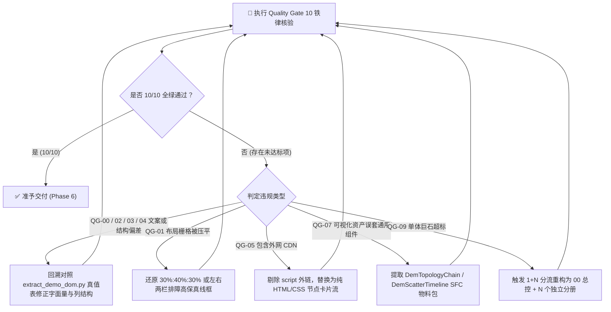

# 交付质量门禁核验标准 (Quality Gate 10 铁律)

在输出《设计说明书》与数据资产包之前，转换技能**必须在内存中强制执行 10 项全项核验**。
只有当 10 项自检全部打钩（10/10 全绿）时，方可通过质量闸门交付给用户。
若发现任何一项不合规，必须立即触发自愈回溯，就地修正受影响的分册，严禁带病交付！

---

## 🚦 Quality Gate 10 大硬核门禁核验表

| 门禁编号 | 检查项目 | 验收标准 (必须 100% 达标) | 典型违规表现 (一票否决) |
| :---: | :--- | :--- | :--- |
| **QG-00** | **[绝对阻断] 零发挥与物理真值 100% 镜像** | 转换前必须先运行 `extract_demo_dom.py`。说明书中的页面标题、Tab 页签、区域标题、卡片文案、表格各列表头、按钮文本必须与真值表 **100% 逐字对应**。 | 凭空臆造源 HTML 不存在的 4 KPI 指标卡、虚构百分比波动（如“较昨日+2%”）、自编打分系统、添加 emoji、臆造重置/导出按钮。 |
| **QG-01** | **容器结构与空间栅格保真度** | 严格比对原 Demo 页面样式与示意图骨架：分栏比例（如 30%:40%:30% 三栏、50%:50% 对等、左侧 240px 侧栏 + 右侧主工作台）、复合排版（卡片大盘+下表明细）必须 100% 物理保真。 | 擅自将 30%:40%:30% 栅格压平为通用指标卡堆叠；将左侧折叠面板粗暴抹去；忽略原原型的复合排版。 |
| **QG-02** | **表头列数与文案 100% 吻合** | 每个表格的 `<th>` 列数、列名必须与原 HTML 逐列对齐。包含复选框选择列（`[复选框]`）与操作/列设置列。原原型 10 列就写 10 列，严禁缩减合并。 | 擅自精简表格列数；漏掉复选框选择列；将 10 列表格缩减为 6 列。 |
| **QG-03** | **筛选控件与占位符吻合** | 输入框 placeholder、下拉选项文字必须 100% 取自源 HTML 真实字面量；所有表单输入项遵循“左文本标题、右输入组件”的水平结构。 | 自行篡改输入框提示文案；下拉选项与源原型不符；表单控件出现上下垂直堆叠。 |
| **QG-04** | **状态徽标与枚举保真度** | Tag 状态标签的枚举字面量（如“差”、“一般”、“正常”、“持续中”）必须 100% 来自源 HTML，语义映射对齐相应颜色 Token。 | 自创“中度风险”、“良好+”等源 HTML 不存在的枚举字面量。 |
| **QG-05** | **100% 离线与内网兼容性** | 100% 杜绝任何外网 CDN 资源（如 jsdelivr, unpkg, cdnjs, google fonts）。系统架构拓扑必须采用**纯内嵌 HTML/CSS 节点卡片流**或内嵌 SVG 实现。 | 说明书 head 中残留 `cdn.jsdelivr.net` 等外部脚本或外网字体，导致内网离线环境加载超时、排版阻塞。 |
| **QG-06** | **组件语义化映射精准度** | 原 HTML 原生或手写元素必须严格机械映射为 IDUX 官方标准组件（`<IxTable>`, `<IxSelect>`, `<IxDrawer>`, `<IxTag>` 等）与相应 Token。 | 原生 `<select>`、手写 `<table>`、原生绝对定位手绘模态浮层残留。 |
| **QG-07** | **特化可视化资产识别保真度** | 四大类可视化资产（趋势图、拓扑图、可视化图表、业务图表）**绝对禁止套用基础 UI 组件**！必须分类明确并保真提取物料（SFC / ECharts）与 Token 字典。 | 将横向拓扑链硬套成垂直 `<IxTimeline>`；将三色底带散点时间线乱套成单色折线图；遗漏趋势图基线配置。 |
| **QG-08** | **交互行为细则与状态机完备度** | 第二章必须包含《🧭 页面核心交互动线与操作行为细则大表》记录因果联动多米诺；第三章必须全覆盖 Loading、Empty、Error、防重复提交四态。 | 只给静态线框图而缺失因果交互说明；产出无交互死页面；缺失异常四态。 |
| **QG-09** | **复杂方案 1+N 分册铁律与可运行契约** | 页面数 ≥2 或代码体积 > 150KB 时，强制拆分为 1 个全局总控 + N 个模块分册；抽取的 `types.ts` 和 `mock-data.ts` 与原 HTML 数据 100% 一致且可直接运行。 | 把多页面方案硬塞成单一超长巨石说明书导致排版降维或上下文截断；类型包含 `any` 敷衍；Mock 数据脱节。 |

---

## 🛡️ 红线阻断与自愈机制

