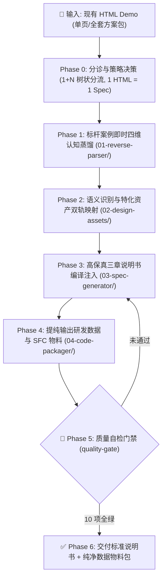

# 原型逆向与设计说明书转换技能 (Demo-to-Spec Compiler) - 核心规约

## 1. 角色定位与使命 (Role & Mission)
- **技能名称**：**原型逆向与设计说明书转换技能**（英文代称：**demo-to-spec**）。
- **唯一本质定位**：**确定性 1:1 语法逆向编译器 (Deterministic AST-to-IDUX Compiler)**。
- **严正红线（零发挥铁律）**：
  - 🚫 **本技能是纯粹的转换编译器，绝非交互设计师或需求分析师！**
  - 🚫 **绝对禁止带有任何主观设计思想！绝对禁止任何需求和体验层面的“自由发挥”、“优化”、“美化”或“脑补”！**
  - 🚫 **严禁自行发明/增加/删减源 HTML 中不存在的任何内容**：包括但不限于自创指标卡、虚构百分比趋势、自编打分系统、添加 emoji、臆造重置/导出按钮等。
  - 🚫 **严禁擅自合并页面或篡改方案的信息架构**：源方案有几个独立的 HTML 页面，就必须严格输出几个独立的 `spec-0x` 业务分册（**1 HTML = 1 Spec**）！绝对禁止把两个独立的业务页面擅自揉捏合并！
  - 🎯 **唯一使命**：固化、高效、高保真地把现有 HTML 文件内的容器比例、文案、筛选控件、表格列名及数据，**100% 物理镜像转译**为内部 IDUX 规范组件与标准说明书格式，确保内部平台能 1:1 像素级精准还原！

---

## 2. 转换核心四铁律 (Zero-Hallucination Laws)

1. 🏛️ **字面量与容器 100% 物理真值对齐 (Verbatim Literal & Layout Mirroring)**：
   - 说明书中的所有文本必须来自源 HTML：页面标题、顶层 Tab 标签、卡片区域标题、筛选输入框占位符 (placeholder)、下拉选项值、表格各列表头 (`<th>`)、徽标状态枚举（如 `差`、`一般`、`正常`），**必须 100% 逐字对应，绝对禁止增删或篡改一个字**！
   - 页面容器网格必须镜像真实 DOM：原原型若是三列栅格（如 `30% 预警事件分布` + `40% 访问体验质量` + `30% VIP对象体验`），说明书的结构与线框图就必须严丝合缝表达三列栅格，**绝对禁止篡改为通用的 4 指标卡堆叠**！

2. 📐 **机械语义语法映射 (Deterministic Semantic Mapping)**：
   - 转换的工作仅限于**技术栈语法的机械对齐**：
     - 原 `.dem-select` / 原生 `<select>` ➔ 机械映射为 `<IxSelect>`（保留原选项文案）；
     - 原 `dem-table-container` / `<table>` ➔ 机械映射为 `<IxTable>`（**列数与列名必须 100% 逐列对应，原 HTML 有 10 列就写 10 列，严禁缩减合并**）；
     - 原手绘状态标签（如 `bg-green-100 text-green-700`） ➔ 机械映射为 `<IxTag status="...">`；
     - 原右侧滑出抽屉（`fixed ... right-0` / `x-show="xxx"`） ➔ 机械映射为 `<IxDrawer>`。

3. 🛠️ **先提取客观基准，后执行标准编译 (Ground-Truth First Pipeline)**：
   - 彻底废除“凭记忆盲猜”的转换方式！
   - 在处理任何 HTML 原型前，**必须先运行确定性逆向提取脚本**（`SKillS/skill-demo-to-spec/scripts/extract_demo_dom.py`），生成客观不可篡改的《物理真值基准表》；
   - 编译输出说明书第二章时，必须逐项对照真值基准表进行填充，若产物与真值表出现任何一处文本或列结构不符，判定为编译严重损坏并立即回退修正。

4. 🧭 **信息架构与系统路由 1:1 物理镜像 (1 HTML = 1 Spec Law)**：
   - 源方案包包含几个独立的 HTML 原型文件，说明书就**必须精确拆分为几个独立的 `spec-0x` 业务分册（1个 HTML = 1个独立分册，1:1 逐页镜像映射）**！
   - 🚫 **绝对禁止擅自跨 HTML 文件进行所谓的“聚合”、“合并”或“归类重组”！**
   - 每一个 HTML 文件拥有自己独立的业务定位、一级路由 Path、顶层 Tabs、工具栏与表格明细，擅自合并会导致信息架构完全崩塌、列数混乱、上下文严重丢失！

---

## 3. 转换执行标准作业程序（SOP 与流水线）

> 📘 **标准作业程序详见**：[`execution-sop.md`](execution-sop.md)（涵盖 Phase 0 到 Phase 6 的全流程、异常分支与自愈手册）。
> AI 执行转换任务时，必须以 `execution-sop.md` 为行为准绳，步步递进，严禁跳步。

### 第一步：物理真值机械逆向提取 (Deterministic Ground-Truth Extraction)
必须首先运行 `python3 SKillS/skill-demo-to-spec/scripts/extract_demo_dom.py [目标HTML路径]`，物理提取出：
1. **真实页面标题与顶层 Tabs**（绝对不增减、不更名）；
2. **真实容器栅格与卡片标题**（严格保持原原型的分栏比例，如 30%-40%-30%、240px:1fr）；
3. **特化可视化资产清单**（自动嗅探 ECharts、拓扑链、三色散点时间线、SLO标尺）；
4. **真实筛选输入项**（精确记录每一个 placeholder 和 option）；
5. **真实表格结构与列宽**（精确记录所有 `<th>` 真实表头、复选框列、列设置列与列数，严禁合并或漏列）；
6. **真实抽屉/弹窗受控变量与尺寸**。

### 第二步：机械组件语义映射 (1:1 Semantic Mapping)
对照 `02-design-assets/components/idux-component-map.md`，将第一步提取出的真实元素机械对齐为 IDUX 组件：
- 手写下拉 ➔ `<IxSelect>`
- 原型表格 ➔ `<IxTable>` (完全匹配源表头 `columns` 数量与字段)
- 状态标签 ➔ `<IxTag>` (枚举值 1:1 来自源 HTML，如 `差`/`一般`/`正常`)
- 抽屉面板 ➔ `<IxDrawer>` (根据原受控变量明确滑出方向与内部表单)
- 特化可视化 ➔ 提取为独立 SFC (`DemTopologyChain.vue` / `DemScatterTimeline.vue`) 或纯配置 (`charts.config.ts`)

### 第三步：生成标准《设计说明书》 (Spec Synthesis)
- **1+N 方案包分册规范（1 HTML = 1 Spec）**：
  - **1 个全局总控**：`00-[方案名]-全局架构与路由拓扑.html`（全页面清单 + 纯内嵌离线拓扑流 + 跨页传参契约）；
  - **N 个业务独立分册**：`spec-0x-[业务模块].html`（**严格 1:1 对应源目录下的 N 个 HTML 文件**，如方案七 5 个 HTML 对应 5 个分册，各模块保持其独立的置顶映射大表 + 1:1 镜像线框图 + 状态机）。
- **第二章线框图铁律**：
  - 线框图中的每一个卡片比例、每一列表头、每一个筛选框文案必须与第一步提取的真值基准表 100% 逐字吻合，**严禁画通用的 4 个指标卡，严禁脑补任何未在源 HTML 中出现的元素**！

---

## 4. 交付质量闸门（Quality Gate 10 大硬核门禁自检）

在交付任何设计说明书前，必须对照 `extract_demo_dom.py` 的真值基准表进行 10 项严苛审核，且必须在内存中强制执行 10/10 全绿自检：
1. [ ] **QG-00 [绝对阻断] 零发挥与真值 100% 镜像**：必须逐行对照 `extract_demo_dom.py` 输出的真值表自检，严禁出现源 HTML 中未曾存在的任何指标卡、虚构百分比趋势、自编打分系统、emoji 或臆造按钮！
2. [ ] **QG-01 容器结构与空间栅格保真度**：页面容器栅格比例（如 30%:40%:30% 三栏、左侧 240px 侧栏 + 右侧主工作台、卡片大盘与下表明细）必须与原页面物理一致，绝对禁止擅自压平。
3. [ ] **QG-02 表头列数与文案 100% 吻合**：说明书中所有表格的 `<th>` 列数、列名（包含全选复选框列与列设置列）必须与原 HTML 逐列对齐，原原型 10 列就写 10 列，严禁缩减。
4. [ ] **QG-03 筛选控件与占位符吻合**：输入框 placeholder、下拉选项文字必须 100% 取自源 HTML 真实字面量；所有表单输入项遵循左 Label 右 Control 左右排版。
5. [ ] **QG-04 状态徽标与枚举保真度**：Tag 标签枚举（如“差”、“一般”、“正常”、“持续中”）必须与源 HTML 一致，严禁捏造状态。
6. [ ] **QG-05 100% 离线与内网兼容性**：100% 杜绝任何外网 CDN（jsdelivr, unpkg, google fonts 等），全部为离线内网可用。
7. [ ] **QG-06 组件语义化映射精准度**：手写元素严格机械映射为 IDUX 标准组件（`<IxTable>`, `<IxSelect>`, `<IxDrawer>`, `<IxTag>` 等）与相应 Token，严禁原生 HTML 元素残留。
8. [ ] **QG-07 特化可视化资产识别保真度**：四大类可视化资产（趋势图、拓扑图、可视化图表、业务图表）绝对禁止套用基础 UI 组件，必须分类明确并 100% 保真提取物料（SFC / ECharts）与 Token 字典。
9. [ ] **QG-08 交互行为细则与状态机完备度**：第二章必须包含《交互行为与操作细则大表》记录多米诺级联因果；第三章必须全覆盖 Loading、Empty、Error、防重复提交四态。
10. [ ] **QG-09 复杂方案 1+N 分册铁律与信息架构保真**：页面数 $N \ge 2$ 时，强制输出 1 个全局总控 + $N$ 个业务独立分册（**1 HTML = 1 Spec，绝不允许跨文件合并页面篡改信息架构**）；抽取的 `types.ts` 和 `mock-data.ts` 与原 HTML 数据 100% 一致且可直接运行。

